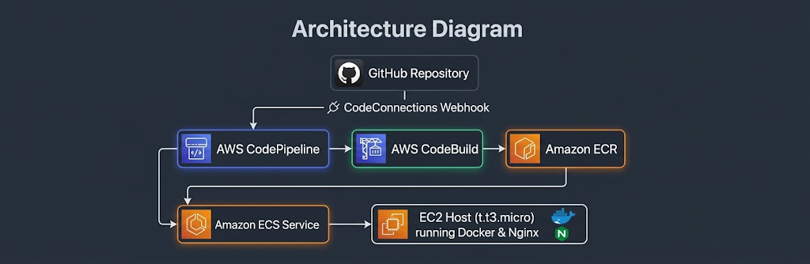

# Claim Zero — AWS Free Tier ECS on EC2 with CI/CD

> A production-style, cost-optimized containerized web application deployed on AWS using Terraform infrastructure-as-code and automated via a GitHub-integrated CI/CD pipeline—all kept strictly within the **AWS Free Tier**.

---

## 🏗️ What I Built
**Claim Zero** is a containerized modern web application built with React and served via Nginx. Rather than relying on expensive serverless orchestrators like AWS Fargate or managed load balancers, this architecture is meticulously engineered for maximum cloud proficiency and zero cost:
* **Compute Layer:** A single `t3.micro` Amazon EC2 instance operating as an ECS container host.
* **Orchestration:** Amazon ECS (Elastic Container Service) using the EC2 launch type, managed via a persistent ECS Cluster and Service configuration (`desired_count = 1`).
* **Container Registry:** Amazon ECR (Elastic Container Registry) to store, version-tag, and lifecycle-manage Docker images.
* **Networking:** Default VPC infrastructure mapped securely via custom security groups, allowing public HTTP traffic (Port 80) directly to the host while restricting unnecessary ingress.
* **Automated CI/CD Pipeline:** AWS CodePipeline (V1) combined with AWS CodeBuild (`BUILD_GENERAL1_SMALL`, privileged mode) linked to GitHub via AWS CodeConnections, enabling fully automated builds and rolling deployments on every git push.

---

## 🚀 Architecture Diagram




## 🛠️ Engineering Hurdles & How I Solved Them

### 1. Multi-Stage Docker Builds & Public ECR Registries
* **The Challenge:** Standard Docker Hub base images (`node:alpine` and `nginx:alpine`) trigger strict rate limits (`429 Too Many Requests`) in automated AWS build environments.
* **The Solution:** Refactored the `Dockerfile` to pull directly from Amazon's managed public mirror (`public.ecr.aws/docker/library/node` and `public.ecr.aws/docker/library/nginx`), ensuring reliable, unthrottled image builds inside CodeBuild.

### 2. CodeBuild Source & Buildspec Path Resolution
* **The Challenge:** Initially, the pipeline failed during the `DOWNLOAD_SOURCE` phase with a `YAML_FILE_ERROR`, complaining that the `buildspec.yml` file did not exist.
* **The Solution:** Identified that `buildspec.yml` was mistakenly placed inside the `terraform/` subdirectory. I relocated it to the **absolute root directory** of the project repository right alongside the `Dockerfile` and `package.json`, ensuring CodeBuild could discover it immediately upon checkout.

### 3. GitHub Handshake & Modern CodeConnections
* **The Challenge:** Connecting AWS CodePipeline to GitHub via Terraform initially creates connections in a `PENDING` state, causing pipeline execution errors (`Connection claim-zero-github is not available`).
* **The Solution:** Navigated to **CodeConnections** under AWS Developer Tools, completed the manual authorization handshake, installed the AWS Connector for GitHub, restricted permissions cleanly to the `claim-zero` repository, and verified status transition to `Available`.

### 4. Regional Hardcoding and Infrastructure Portability
* **The Challenge:** Hardcoded configuration variables locked resources to `us-east-1`, raising friction when adapting deployment targets to alternative regions like `eu-north-1`.
* **The Solution:** Consolidated regional parameters inside a modular `locals` block (`region = "eu-north-1"`) and leveraged dynamic Terraform interpolations (`${local.region}` and `${local.account_id}`) across all provider declarations, ECR policies, and pipeline definitions.

---

## 💡 What I Learnt

* **Infrastructure as Code (IaC) Mastery:** Gained hands-on proficiency with Terraform state initialization, data source lookups (such as fetching default VPCs and SSM Parameter Store AMIs), and resource dependency mapping.
* **The Reality of CI/CD Workflows:** Understood the exact mechanics of artifact generation (`imagedefinitions.json`), S3 temporary staging buckets, IAM execution role handoffs, and rolling ECS deployments.
* **Cost Governance in Cloud Engineering:** Learned how to design architectures around cloud provider constraints—balancing production-grade automation patterns (pipelines, containers) with the strict cost boundaries of the AWS Free Tier.
* **System Troubleshooting:** Developed a systematic approach to reading container logs, parsing CodeBuild phase failures, and tracing permissions issues across IAM trust policies.

---

## 🛑 Clean Up & Teardown
To prevent unexpected AWS charges after completing the project, the entire infrastructure was cleanly wiped out using:
```bash
cd terraform
terraform destroy